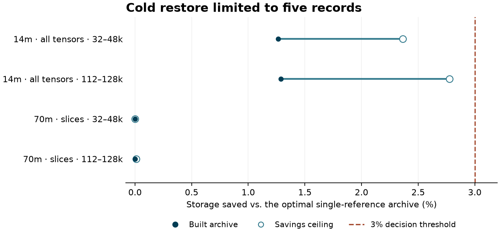

# 给训练快照加第二个参考版本，能省多少空间？

这是一个离线权重归档实验。部署者想保留训练过程中的不同版本，偶尔完整取回其中一个。若允许用前后两个版本预测中间权重，存储预测残差就可能更便宜。但解码中间版本必须先取回两个参考，它们也各有自己的依赖。实验比较的是全部 17 个版本合起来占多少字节，以及取回任一版本实际要读取多少数据。

## 决策与结果

**以技术报告收尾。** 主比较的四个窗口都没达到预设的 3% 投入门槛。即使用这套编码器和参考对找到全局最好的双参考布局，四组各自的节省上界也都低于 3%。因此扩大布局搜索或为这个预测器投入更多计算，无法在这些输入上翻转决策。两个完整模型窗口存在可复现的小收益，同时增加了平均取回成本。

| 数据与训练步数 | 单参考全档（字节） | 允许双参考的实物全档（字节） | 实测节省 | 所有候选布局的节省上限¹ | 平均冷读，单参考 → 双参考（十进制 MB） |
| --- | ---: | ---: | ---: | ---: | ---: |
| 14m 全部，32k–48k | 337,170,264 | 332,910,548 | 1.26% | ≤2.37% | 73.93 → 82.53 |
| 14m 全部，112k–128k | 285,235,036 | 281,557,407 | 1.29% | ≤2.78% | 65.75 → 70.27 |
| 70m 切片，32k–48k | 11,921,723 | 11,921,723 | 0% | ≤0.002% | 2.44 → 2.44 |
| 70m 切片，112k–128k | 10,832,331 | 10,832,331 | 0% | ≤0.010% | 2.39 → 2.39 |

¹ 为保持上界含义，表中上限向上取整至所示位数。所有主比较都将目录、记录及解码所需的数据计入，单参考和允许双参考的两种归档各对 68 个目标逐一发起独立恢复。每次从空的版本缓存开始，按位置读取目录及递归依赖，核对收到的字节数和恢复文件的 SHA-256。[逐组数据](results/summary.json)



**中间一帧确实变小。** 两个 14m 档分别有 14 和 13 个双参考版本。固定同一布局，只禁用中点、仍允许每块选择左右端点，两个完整归档分别多占 9.65 MB 和 8.65 MB。让单参考自己选择整套最优布局后，双参考的净优势只剩 4.26 MB 和 3.68 MB。冷读预算改为 3 条记录时，两个窗口的归档节省为 0.17% 和 0.11%。改为 8 条时为 0.78% 和 0.80%，此时平均冷读分别减少 1.42% 和 0.44%。原生 70m 切片在这三个预算上的实测最优可行方案都只用了单参考。

**精度带来的收益更大。** 两个 70m 窗口中，每个窗口的 7,241,728 个原始 FP32 值都能用 FP16 精确表示，原生 FP32 中点只有 45.20% 和 47.10% 仍在该网格上。另做事后对照，两边都先无损收窄，再恢复原始 FP32 文件。仅改变单参考存储表示就各省 16.36% 和 18.42%。加第二个参考再省 1.17% 和 1.19%，平均冷读却各增加 16.8% 和 7.1%。这说明检验权重实际精度会实质性改变该归档的大小。这两段切片无法代表一般 FP32 权重，观察本身也不足以支撑一项新的通用压缩方法。[精度逐值统计](results/precision.json) · [无损收窄对照](NARROW.md)

## 数据与对照

从同一个 Pythia 系列取两个训练窗口，分别为 32,000–48,000 步与 112,000–128,000 步，每 1,000 步取一帧。Pythia-14m 使用 34 份完整 safetensors，每份含 76 个张量。Pythia-70m 使用另外 34 个版本中 13 个张量各自中央的 32,768 个值，覆盖输入嵌入和六层的注意力、MLP 权重。共 1,014,876,608 字节。模型及训练窗口之间有关联。本实验的总体是公开模型权重，训练恢复需用的优化器和随机数状态超出范围。[数据来源与校验](SOURCES.md)

先在提交 `665a722` 固定候选、样本、主约束和投入标准。每次取回版本至多读取五条不同的版本记录，含目标自身，共享祖先只计一次。按各版本等概率被请求计算平均冷读字节，包括目录和所需记录。预设继续条件是四组里至少三组全档节省 3% 或以上，其中至少一组是完整模型，同时这些组的平均冷读字节没有增加。3% 是本次投入决策的门槛。[预定协议](PROTOCOL.md)

单参考方案可以选其余 16 个版本中的任意一个，也可以独立存储。双参考方案增加半径 1、2、4、8 个版本的对称参考对。它在每个块内选左参考、右参考或两者的中点，中点用 FP64 计算后舍入到当前存储精度。两边使用相同的可逆编码器，按编码后的实际字节在原值、异或、单调整数序中的位移和按参考指数编码的位移之间选择。完整归档每块 262,144 个元素。归档计入目录、压缩的原始 safetensors 文件头、引用编号、块长度和预测方式标记。[块编码器](codec.py) · [归档读写与校验](storage.py)

**搜索质量可以和压缩效果分开判断。** 按协议先在八个固定位置的 4,096 元素块上选布局，再将布局在整份输入上编码并复核。此外，对全部入选元素逐一编码所有合法单参考和双参考候选，得到每个版本独立存储的成本、272 条有向单参考成本和 38 个双参考选项的成本。对每个读取上限，动态规划求出全局最小的单参考归档。双参考图采用多起点搜索给出可实现解，并计算覆盖所有合法布局的界。[完整成本](full_costs.py) · [单参考最优解](forest.cpp) · [双参考布局](plans.py)

上界的推导用到了可恢复性。将每个双参考选项固定归给它的某一个端点，保留双参考的优惠价格。任何合法双参考图删除另一条边之后，都得到读数不增加的单参考森林。优化这个允许优惠价的单参考问题，得到的字节数至多等于真正最优双参考归档。用几个端点分配规则各算一次，再取最大的下界。若最优单参考为 S，双参考字节数下界为 L，则最佳节省至多为 (S−L)/S。另用限制求解时间的混合整数规划做交叉检查，主表取有效界中较紧者。[计算及消融](experiment.py) · [独立求界](certify.py)

## 已有研究与外推范围

ModelHub 已经研究过如何为版本化权重选择差分关系。ULPack 也直接考察过用前后两个快照预测中间值，在 BLOOM 和 MultiBERTs 的 20 个三版本例子中，理想化的整组三版本成本全部上升。本实验补充了读取依赖数受限、17 版本整体布局、实物归档及其节省上界。这里使用自行实现的编码器，结果无法作为 ULPack 软件的实测。[ModelHub](https://arxiv.org/abs/1611.06224) · [ULPack 附录 G](https://arxiv.org/html/2610.14184v1#A7)

上界适用于这批权重、这套编码器、对称参考对和按整条版本记录读取的约束。块级独立寻址、非对称预测器、不同训练轨迹或优化器状态会改变可行集合。实验数据也不能估计真实对象存储服务的延迟、带宽或账单。

## 复现

按数据说明取回公开权重后，在项目根目录运行下列命令。Python 3.14 的标准库提供 Zstandard 接口，另需 NumPy、SciPy、Matplotlib 及 C++17 编译器。此次环境为 Python 3.14.10、NumPy 2.5.5、SciPy 1.18.1、Matplotlib 3.11.2、Zstandard 1.5.7。二进制归档及中间缓存写入本地 scratch 目录，Git 保存固定输入清单、源代码、逐边成本、实际归档大小与校验结果。限时整数规划可能随 CPU 型号和负载返回不同的界，整数森林松弛无需设限求解。[复现数据](SOURCES.md) · [结果目录](results/)

```sh
./reproduce.sh /path/to/pythia-corpus
```
